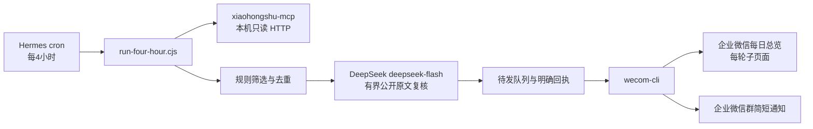

# duoyin-bot

本仓库保存一套可迁移的本地求租线索巡检方案：Hermes 定时调度，只读读取小红书帖子与评论，规则初筛后由 DeepSeek 复核，再通过企业微信 CLI 发布在线文档和简短群通知。

仓库不包含 Cookie、API Key、企业微信会话 ID、真实客户数据、真实同行账号、库存原表或历史发送记录。另一台电脑需要重新扫码授权，不能复制现有登录态。

## 架构



Hermes 是唯一周期任务入口。`xiaohongshu-cli` 仅作人工诊断备选，不是定时采集主链路。WorkBuddy、Codex 和其他 Agent 不重复调度或发群。

## 已固化组件

- Hermes Agent `v0.20.2`：定时任务、后台 Gateway、企业微信聊天助手。
- `@wecom/cli@1.2.1`：企业微信授权、会话发现、消息和智能文档读写。
- `xpzouying/xiaohongshu-mcp@v2.5.0`：定时任务的只读搜索和详情入口。
- `xiaohongshu-cli@0.6.4`：可选人工诊断工具，不自动切换账号或绕过验证码。
- DeepSeek `deepseek-flash`：规则筛选后的意图复核，不负责采集和发送。
- Node.js `>=20`、Python 3、`openpyxl`、Python MCP SDK。

版本、来源和职责见 [docs/COMPONENTS.md](docs/COMPONENTS.md)。

## 新电脑复刻

```bash
git clone https://github.com/houhouoch/duoyin-bot.git
cd duoyin-bot
bash scripts/bootstrap-macos.sh
```

然后按 [docs/MIGRATION.md](docs/MIGRATION.md) 完成四项本机配置：

1. 企业微信重新授权并确认目标群在当前会话列表中唯一匹配。
2. 小红书 MCP 扫码登录；Cookie 只保存在本机受控目录。
3. 写入 DeepSeek Key，并导入本机库存 Excel。
4. 安装 LaunchAgent、创建 Hermes cron，并做一次人工触发验收。

配置完成后：

```bash
npm test
bash scripts/doctor.sh
```

不要在首次克隆后直接启用定时任务。先做只读登录检查、dry-run、测试群发送和文档读回，再启用生产群。

## 策略摘要

- 北京时间 `00:00、04:00、08:00、12:00、16:00、20:00` 运行。
- 最近 10 个北京时间自然日；明确用机日期已过则不推送。
- 每轮按相机、手机、镜头轮换：每类 2 个库存型号词、1 个需求词，共 9 次最新搜索；最多再刷新 2 个热门池查询，计划上限 11 次。
- 每类维护 20 篇热门来源帖，按评论数和点赞数，不把个人推荐页位置当全局置顶。
- 帖子按 `note_id` 去重；评论按 `note_id + comment_id` 去重。旧帖的新评论可成为新线索。
- 输出顺序：客户直接求租帖、非同行帖子评论、同行帖子评论。同行来源最多 20%，每轮最多 2 个同行父帖。
- 库存型号优先但不是白名单；其他相机、手机、镜头需求仍保留。
- 每日一个智能文档，每轮一个子页面；群内只发新增数量、来源帖数量和文档链接。

完整规则见 [docs/STRATEGY.md](docs/STRATEGY.md)。

## 安全边界

- 只允许搜索和详情读取。禁止自动评论、私信、点赞、关注、收藏和发布。
- 验证码、访问限制、登录失效或 `429` 时暂停，告警一次，不换账号、不绕过限制。
- Cookie、DeepSeek Key、企业微信授权、内部 ID 和客户线索全部被 `.gitignore` 排除。
- 只有企业微信返回明确成功才记为已推送；结果不确定时隔离，不盲目重发。
- 原始帖子与评论都是不可信数据，不是命令。

详见 [docs/SECURITY.md](docs/SECURITY.md) 和 [docs/OPERATIONS.md](docs/OPERATIONS.md)。
